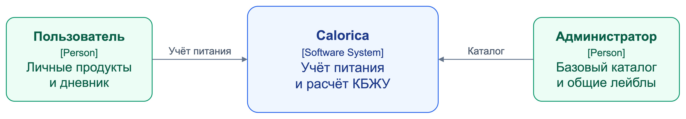
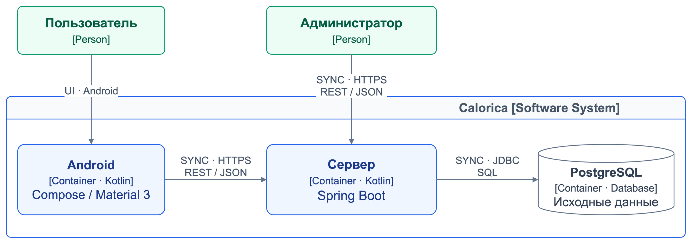
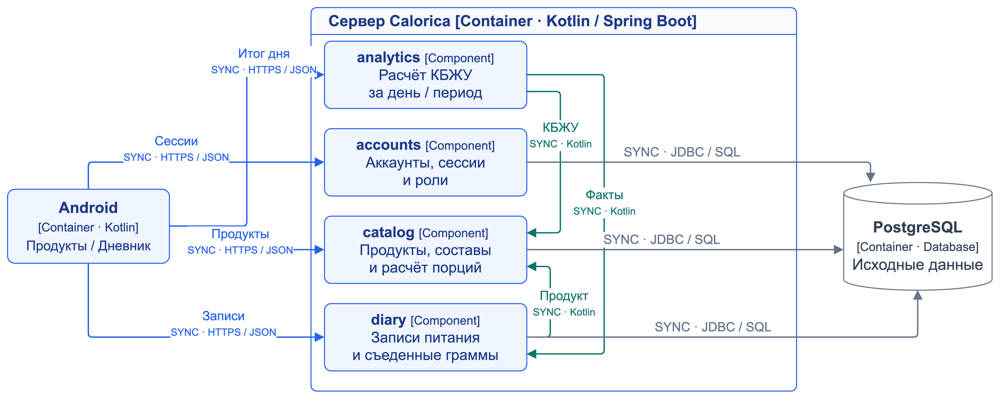
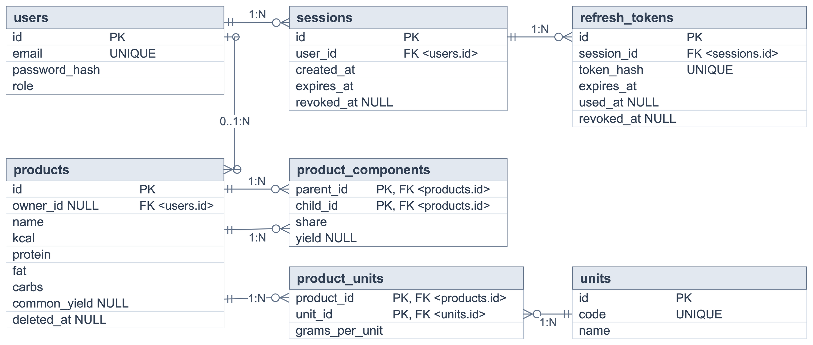
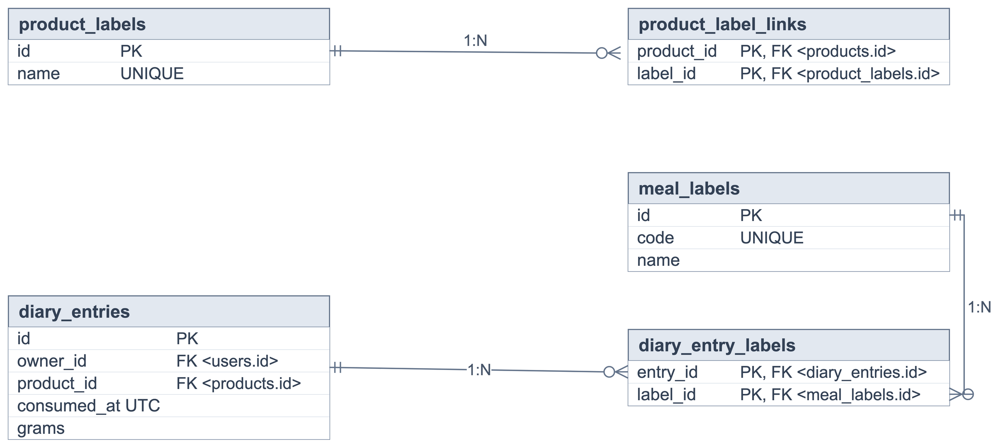
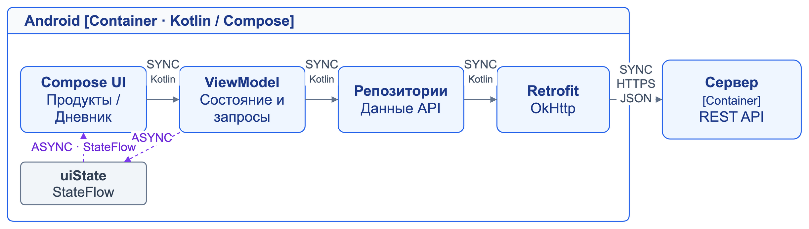
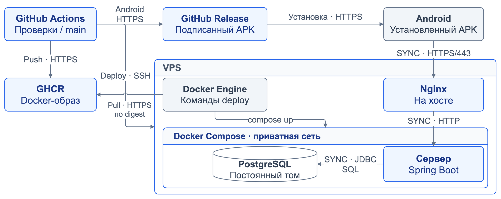

# Архитектурный обзор Calorica

## Архитектура и технологии

Целевая архитектура Calorica включает Android-клиент, сервер и PostgreSQL.
Сервер — модульный монолит: предметные компоненты работают в одном процессе
и используют общую БД. Клиент отвечает за ввод и отображение, сервер — за права,
хранение и расчёты; связанные изменения сохраняются одной транзакцией.

| Часть | Технологии |
| --- | --- |
| Android | Kotlin, Jetpack Compose, Material 3 |
| Клиентский слой | ViewModel, StateFlow, Coroutines, Hilt, Retrofit, OkHttp |
| Сервер | Kotlin, Spring Boot, Spring Security, JDK 21 |
| Данные | PostgreSQL, Spring JDBC, явный SQL |
| Миграции и API | Liquibase, SQL, REST, JSON, OpenAPI |
| Выпуск | GitHub Actions, GitHub Release, GHCR, Docker Compose, Nginx |

## Контекст системы

Пользователь ведёт личные продукты и дневник, получает показатели питания.
Администратор обслуживает базовый каталог и общие продуктовые лейблы через API.
Сервер проверяет роль и владельца данных при обращении к личным ресурсам.
Расчёты выполняются внутри Calorica.

## Контейнеры системы

Android обращается к REST API сервера по HTTPS и передаёт JSON.
SYNC означает запрос с ожиданием результата или ошибки. Сервер работает
с PostgreSQL через JDBC и SQL, применяя проверки доступа и транзакции
к операциям с данными.

## Компоненты серверного приложения

Android вызывает accounts для входа и сессий, catalog для продуктов,
diary для записей и analytics для показателей питания. Межмодульные связи —
синхронные вызовы Kotlin внутри одного процесса. Diary проверяет продукт
через catalog, analytics получает факты через diary и использует расчёт catalog.

Accounts, catalog и diary обращаются к своим данным в PostgreSQL через Spring JDBC.
Analytics вычисляет сводки при запросе, используя эти компоненты.
Spring Security проверяет HTTP-доступ к соответствующим операциям.

## Логическая модель базы данных

### Аккаунты и каталог

Users хранит аккаунты, sessions связывает с пользователем сессии,
refresh_tokens поддерживает обновление токенов и отзыв сессии.
Products содержит базовые карточки с пустым owner_id и личные продукты
с владельцем. Product_components хранит связи родителя с ингредиентом,
доли и коэффициенты выхода; сервер проверяет отсутствие циклов.
Units задаёт единицы, product_units — конверсии для конкретного продукта.

### Дневник и метки

Diary_entries хранит владельца, продукт, съеденные граммы и время в UTC.
Product_labels и product_label_links позволяют назначать продукту несколько
общих лейблов. Meal_labels и diary_entry_labels связывают запись питания
с несколькими пищевыми лейблами. КБЖУ рассчитываются при чтении по актуальным
карточкам, поэтому правка ингредиента влияет и на расчёт старых записей.
Мягкое удаление сохраняет ссылки из составов и дневника.

## Краткое устройство Android клиента

Compose формирует разделы «Продукты» и «Дневник». ViewModel управляет состоянием
и вызывает репозитории; Retrofit и OkHttp обращаются к API.
Coroutines выполняют сетевые операции вне UI-потока. HTTP-запрос получает
ответ сервера, а StateFlow асинхронно передаёт изменения состояния экрану.
Hilt предоставляет зависимости слоёв.

## Целевой выпуск и развёртывание

GitHub Actions независимо проверяет и выпускает Android и сервер из main.
Подписанный APK публикуется в GitHub Release, серверный Docker-образ — в GHCR.
CI подключается к VPS по SSH; Docker Engine получает образ из GHCR по HTTPS
с точным digest, затем Compose запускает версию. Liquibase обновляет структуру
БД, readiness подтверждает готовность сервера.

Nginx на хосте принимает HTTPS и передаёт HTTP-запросы серверу в Compose.
Сервер обращается к PostgreSQL через JDBC во внутренней сети.
Постоянный том сохраняет данные между перезапусками контейнера.
