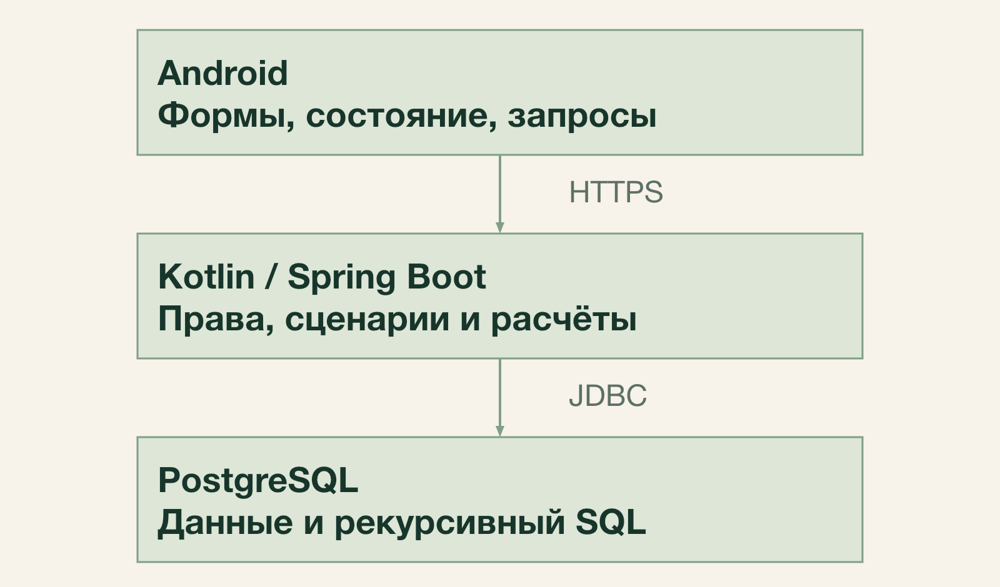
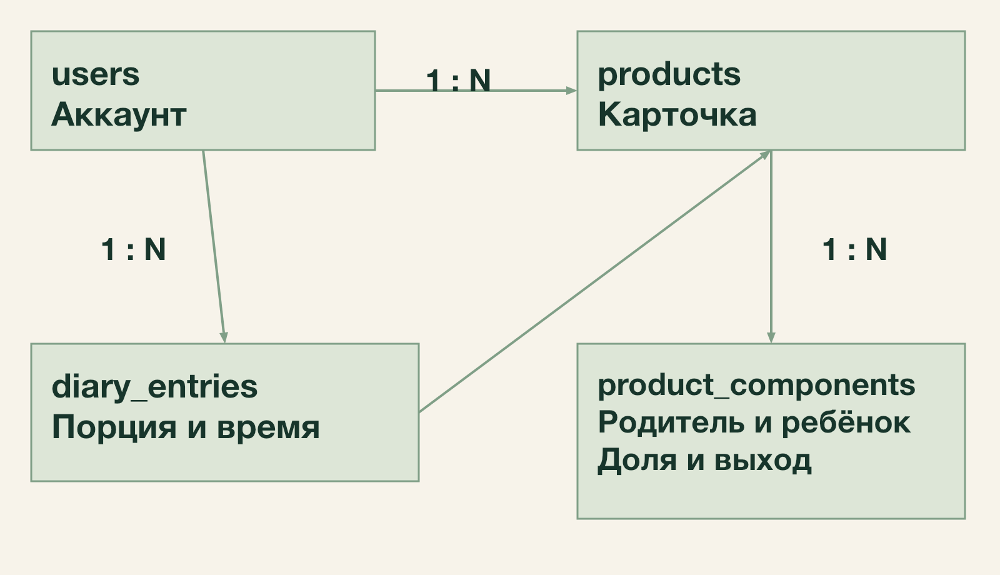
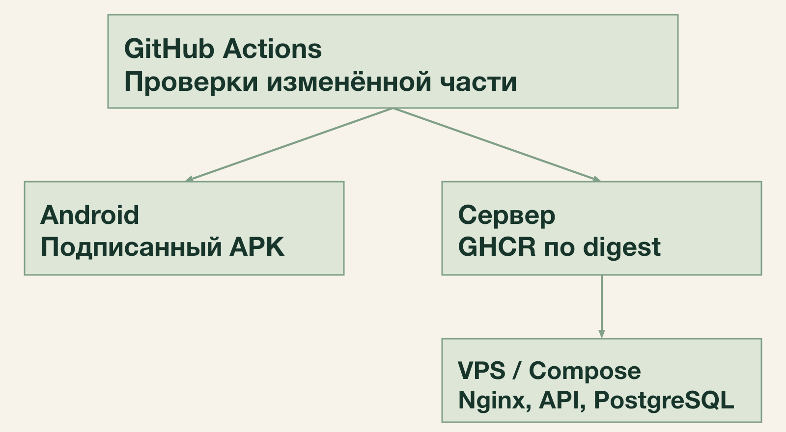
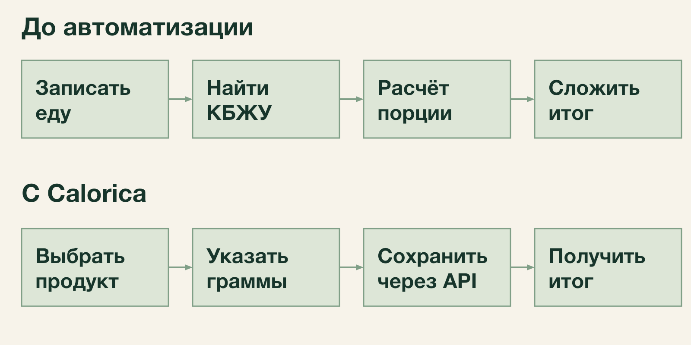

# Архитектура семестрового MVP Calorica

## Технологии и причины выбора

Calorica использует клиент-серверную архитектуру. Android отвечает за ввод и
отображение, сервер проверяет доступ и рассчитывает показатели, PostgreSQL хранит
нормализованные данные. Все компоненты находятся в одном репозитории.

| Компонент | Технологии | Назначение |
| --- | --- | --- |
| Android | Kotlin, Jetpack Compose, Material 3, Hilt | Экраны, состояние форм, внедрение зависимостей |
| Сервер | Kotlin, Spring Boot, Spring Security, JDK 21 | REST API, сценарии, сессии и права |
| Хранение | PostgreSQL, Spring JDBC, явный SQL | Транзакции, поиск и рекурсивные расчёты |
| Миграции | Liquibase, рукописный SQL | Схема, справочники и начальный каталог |
| Контракт | REST, JSON, OpenAPI | Описание запросов, ответов и ошибок |
| Выпуск | GitHub Actions, Docker, GHCR, Compose, Nginx | Независимые сборки и автоматическое развёртывание |

Kotlin сохраняет совместимость с экосистемой JVM и позволяет использовать один
язык на клиенте и сервере. Compose соответствует существующему Android-каркасу.
Модульный монолит объединяет серверные операции в одном процессе и одной БД:
изменение состава не требует распределённой транзакции. Явный SQL подходит для
рекурсивного графа продуктов и проверки фактического плана запроса.

Android собирается из app/, сервер — независимо из backend/. Версии библиотек
закреплены в соответствующих Gradle-файлах; версии и выпуски двух компонентов
не зависят друг от друга. Минимальная версия Android — API 26.

## Компоненты и внутренние границы

Клиент обращается только к HTTPS API. На Android экран Compose получает состояние
от ViewModel; слой доступа к API выполняет запрос и преобразует ответ в состояние
экрана. В памяти остаются данные текущего экрана. После записи клиент повторно
запрашивает затронутые данные. Источник истины — сервер.

Сервер разделён пакетами accounts, profile, catalog, diary, analytics и platform.
Accounts отвечает за учётные записи и сессии; profile — за личные ориентиры;
catalog — за продукты, составы, единицы и продуктовые лейблы; diary — за факты
питания; analytics — за календарные сводки. Platform содержит общие технические
средства: подключение БД, безопасность и единый формат ошибок.

Внутри предметного модуля слой api принимает DTO, application выполняет сценарий
и задаёт транзакцию, domain описывает правила, persistence содержит JDBC и SQL.
Другие модули обращаются к операциям catalog, а не изменяют его таблицы напрямую.
Расчёт карточки, дневника и сводки использует общий механизм SQL.

## Модель данных и ограничения

Products объединяет базовые и личные продукты. Owner_id равен NULL для базовой
карточки; иначе указывает владельца. Карточка содержит название, нормализованное
название, ручные КБЖУ, необязательный общий выход и is_deleted. Тип продукта
определяется наличием компонентов, а не отдельным флагом.

Product_components хранит parent_product_id, child_product_id, исходную долю и
nullable-выход ингредиента. Пара родитель–ребёнок уникальна; ссылки защищены внешними
ключами. Прямое включение себя, неположительная доля или выход отклоняются.
Сумма долей и отсутствие косвенного цикла проверяются сценарием в транзакции.

Diary_entries хранит владельца, ссылку на продукт, съеденные граммы и occurred_at
типа timestamptz. КБЖУ и единица ввода не копируются. Историческая ссылка сохраняется
при мягком удалении продукта. Лейблы связаны отдельными таблицами: product_labels,
product_label_links, meal_labels, diary_label_links. Пары связей уникальны.
Unit_types и product_unit_conversions задают доступные единицы и граммы на единицу.
Users, user_profiles, sessions и refresh_tokens хранят аккаунты, необязательные
ориентиры и состояние сессий. Refresh_tokens содержит хеши, а не исходные токены.

Индексы: product_components по ребёнку для обратных зависимостей и по родителю
для раскрытия; diary_entries по владельцу и времени; products по владельцу и
is_deleted. Поиск использует GIN pg_trgm для нормализованного имени и индекс
префикса. Одно правило нормализации применяется к запросу и сохраняемому имени.

## API и целостность изменений

Версионируемый префикс API — /api/v1. OpenAPI описывает обязательность полей,
десятичную точность, диапазоны и возможные ошибки. В числах не используется
промежуточное преобразование через Float или Double.

| Группа | Основные операции |
| --- | --- |
| /auth | Регистрация, вход, refresh и выход |
| /products | Поиск, карточка, создание и изменение; состав и выход одной операцией |
| /products/{id}/deletion-preview | Предпросмотр каскада; выполнение удаления повторно проверяет данные |
| /diary | Создание, изменение и удаление записи; список по локальной дате и поясу |
| /analytics | Сводка по дате, периоду и IANA-поясу |
| /profile, /labels, /units | Ориентиры, доступные справочники и разрешённое управление |

Входной owner_id не является полномочием: сервер берёт пользователя из активной
сессии и проверяет доступ. 400 обозначает некорректный запрос, 401 — отсутствие
действительной сессии, 403 — недоступную операцию роли, 404 — отсутствующий или
чужой личный объект, 409 — конфликт состояния, например цикл, 429 — ограничение
частоты. Ошибка имеет формат application/problem+json и correlationId.

Изменение графа работает в READ COMMITTED. До чтения графа берутся транзакционные
advisory-блокировки в описанном ниже порядке. Затем проверяются актуальные права,
циклы, сумма долей и режим выхода. Новые связи и коэффициенты фиксируются одним commit.
Чтение расчётного ответа использует один SQL-снимок, а несколько запросов —
read-only REPEATABLE READ. Для защиты от устаревшей формы действует последнее
успешное сохранение; транзакционные проверки при этом обязательны.

Для гонок с базовым каталогом используется его отдельный ключ: личные изменения
графа берут shared advisory lock базового каталога, затем exclusive lock своего
владельца; изменения базового каталога берут exclusive lock его ключа.
Личные графы разных владельцев меняются параллельно. Admin выполняет проверку
зависимостей и удаление под тем же ключом; при чужих личных зависимостях каскад
отклоняется без раскрытия их состава. Порядок ключей един для всех сценариев.
Встроенный SQL REFERENCES не заменяет проверку мягкого удаления.

## Расчёт состава и питания

Для добавления связи родитель–ребёнок сервер рекурсивно проверяет, достижим ли
родитель из ребёнка. Если достижим, операция создаёт цикл и отклоняется.
Проверка достижимости посещает вершины без повторов; ожидаемая алгоритмическая
сложность обхода — O(V + E) в достижимом подграфе. Это не оценка времени всех SQL
операций и не сложность расчёта всех путей вложенного состава.

Доли исходных ингредиентов хранятся с точностью 12 знаков. Для входных граммов
сервер распределяет остаток округления по наибольшим дробным остаткам со стабильным
порядком ID, чтобы сумма долей была ровно 1. Проценты с суммой не 100% отклоняются.
Массы рецепта после нормализации не сохраняются.

Если хотя бы на одной связи задан выход, общий выход равен сумме произведений
исходных долей на выходы ингредиентов; пропущенный выход связи равен 1.
Иначе применяется общий коэффициент карточки или 1. Явная 1 на связи включает
режим ингредиентов. Одновременное задание двух режимов отклоняется.

WITH RECURSIVE раскрывает продукт до листьев. При переходе к компоненту множитель
КБЖУ умножается на его исходную долю и делится на выход родителя. Вклад листа
суммируется по каждому пути; UNION ALL сохраняет общие ингредиенты. Защитная
проверка пути обнаруживает испорченный цикл и возвращает ошибку целостности,
а не частичный результат. Ограничение времени запроса также не возвращает
частичный расчёт.

КБЖУ порции равны съеденным граммам, делённым на 100 и умноженным на актуальные
КБЖУ продукта. Коэффициент ингредиента не умножает нутриенты повторно. Для лейблов
используется отдельное распределение граммов: при выходе по связям готовая доля
равна исходной доле, умноженной на выход связи и делённой на выход родителя;
при общем выходе используется исходная доля. Распределение повторяется до листьев.

Создание записи питания проверяет доступность продукта под теми же блокировками:
сначала shared-ключ базового каталога, затем ключ владельца. После получения
блокировок карточка читается заново. Это не позволяет одновременно удалить
продукт и добавить новую запись с уже недоступной карточкой. Существующие
исторические ссылки при этом сохраняются.

Контроль: доли 50/50%, калорийности 400 и 80 ккал/100 г, выходы 0,5 и 1,5 дают
выход блюда 1 и 240 ккал/100 г. Порция 200 г даёт 480 ккал и распределение 50/150 г.
Числа NUMERIC/BigDecimal округляются для отображения только после суммирования.

## Безопасность и развёртывание

Пароли хешируются Argon2id. Access JWT действует 15 минут, refresh-сессия —
не более 30 дней с момента входа. Refresh ротируется атомарно; повтор использованного
токена отзывает сессию. Сервер проверяет активность сессии и актуальные права.
В Android access хранится в памяти, refresh защищён ключом Keystore и исключён
из резервного копирования. Одна операция refresh выполняется одновременно.

Время записи передаётся ISO 8601 с Z и хранится как Instant/timestamptz.
Для выборки клиент передаёт локальную дату и IANA-пояс. Сервер рассчитывает границы
календарного периода, переводит их в UTC и использует полуоткрытый диапазон.
Смена часового пояса меняет группировку, но не сохранённый момент времени.

GitHub Actions выбирает изменённый компонент. После успешных проверок main
выпускает подписанный APK либо Docker-образ сервера. Документационные изменения
не запускают тяжёлые сборки и релизы. Сервер доставляется из GHCR по digest;
Compose запускает API и PostgreSQL в отдельной сети, Nginx завершает HTTPS.
База не доступна из интернета. Хост и секреты передаются конфигурацией, поэтому
перенос на отдельный VPS не меняет бизнес-код.

Перед миграцией создаётся копия. Readiness проверяет доступность БД и схемы,
liveness — жизнеспособность процесса. При неудаче деплоя возвращается предыдущий
совместимый образ; разрушительный откат БД автоматически не выполняется.
Копии создаются ежедневно и перед миграциями, одна защищённая копия хранится вне
VPS, восстановление проверяется на отдельной БД. Применённые миграции не меняются.

## Бизнес процессы и проверка архитектуры

В ручном процессе человек сам ищет значения, пересчитывает порцию и складывает
результат. В Calorica он выбирает продукт и съеденные граммы; сервер сохраняет
запись и по запросу возвращает дневной итог. Изменение ингредиента влияет на
следующий расчёт, включая старые записи. При таймауте запись автоматически не
повторяется: клиент повторно загружает дневник для проверки результата.

| Требования | Архитектурное решение | Проверка |
| --- | --- | --- |
| SM-01, SN-01 | Серверные сессии, Security и Keystore | Вход, отзыв, refresh, чужие данные |
| SB-01, SB-02, SN-02 | Граф, advisory locks и транзакции | Вложенность, циклы и гонки удаления |
| SM-08, SB-06, SN-03 | Общий рекурсивный SQL и NUMERIC | Контрольные числа, общие пути, пустые дни |
| SM-06, SB-03 | Граммы в дневнике и UTC-моменты | Порция, конвертация, граница локального дня |
| SN-04, SN-07, SN-08 | Liquibase, отдельные workflows и копии | Миграции, выпуск, восстановление |

Интеграционные проверки выполняются на PostgreSQL. Для графа обязательны два
параллельных изменения одного владельца и параллельное удаление базового продукта
с созданием личной зависимости. Для вычислений проверяются общий лист по разным
путям, вложенный выход и различие NULL/1. Для границ модулей проверяется, что
дневник и аналитика используют общий расчёт, а Android получает итог из API.
