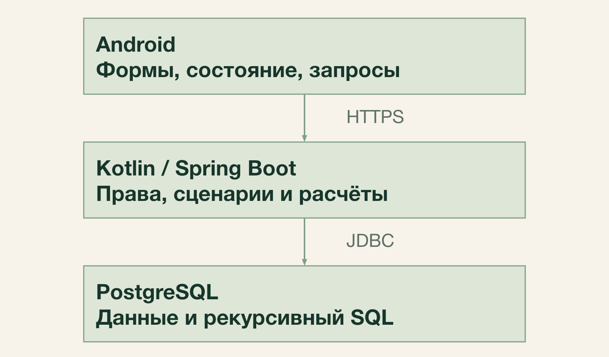
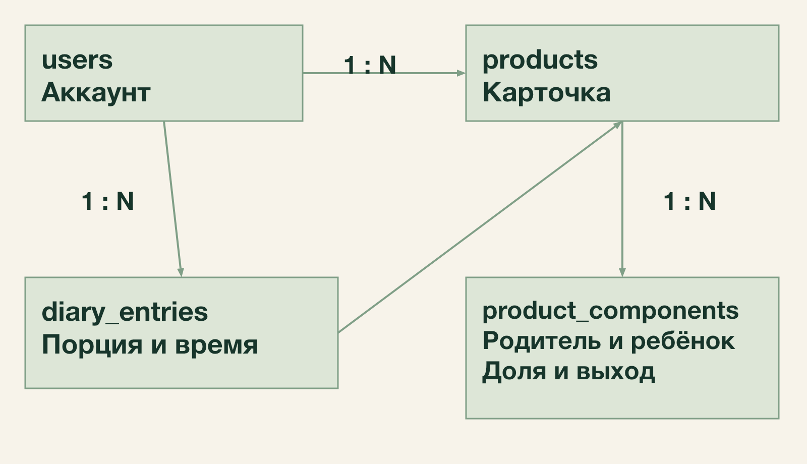
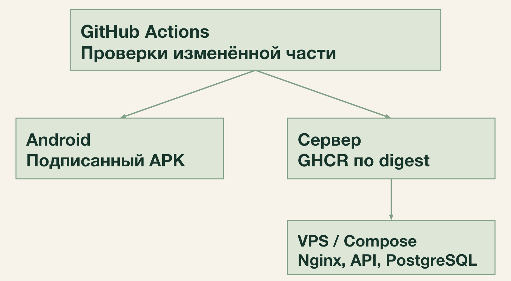
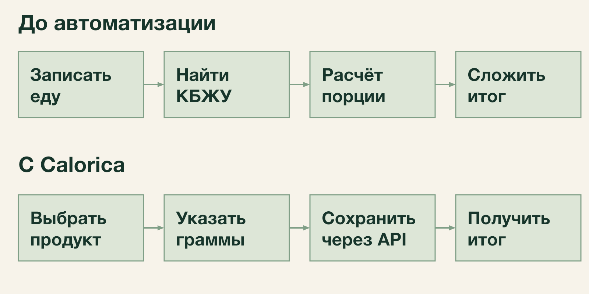

# Техническое задание Calorica

## Назначение и границы

Calorica — мобильное приложение для учёта питания, калорий, белков, жиров и
углеводов с серверной частью. Оно предназначено для человека, которому нужно
видеть свой рацион без ручного подсчёта показателей. КБЖУ означает калории,
белки, жиры и углеводы; MVP — минимальная работоспособная версия.

Результат семестра — Android-приложение, в котором пользователь входит,
выбирает или создаёт продукт, записывает съеденное и видит дневные КБЖУ.
Сервер хранит данные, проверяет права и выполняет расчёты.

### Объём поставки

- В Android два раздела: «Продукты» и «Дневник». Состав вводится процентами,
  съеденная порция — граммами. Дневной итог представлен числовой сводкой.
- На сервере сохраняется целевая модель: вложенные составы, коэффициенты выхода,
  конвертация единиц, лейблы, права доступа и два режима мягкого удаления.
  Дополнительные операции сервера проверяются через API — программный интерфейс.
- В поставку входят подписанный установочный APK, развёрнутый сервер, исходный
  код, миграции БД, описание API, инструкции и результаты приёмочных проверок.

### Основание и команда

ТЗ объединяет требования второго этапа и архитектуру третьего этапа учебного
проекта: технологии, компоненты, модель данных и взаимодействие системы.

Формальные роли: Валера — DevOps-инженер; Камила — тестировщик; Богдан и Николай —
разработчики; Рауль и Мария — аналитики. Все участники могут работать с агентами.

## Функции Android приложения

**SM-01. Аккаунт.** Регистрация по email и паролю, вход, восстановление сессии
при повторном запуске и выход. Для регистрации достаточно email и пароля.

**SM-02. Каталог.** Общий список базовых и собственных продуктов, поиск по названию
и карточка с актуальными КБЖУ на 100 г. Начальный каталог содержит около 50 продуктов.
Поиск нормализует регистр, «ё/е», «ъ/ь»; точные и префиксные совпадения выше похожих.
Для короткого запроса используется префикс, для опечаток — триграммный поиск.

**SM-03. Личный продукт.** Создание и изменение названия и ручных КБЖУ на 100 г.
Удаление мягкое: карточка исчезает из выбора, но сохраняется в составах и истории.
Базовые продукты в Android только просматриваются.

**SM-04. Состав.** Выбор компонентов, включая составные продукты, ввод и изменение
процентов с суммой ровно 100%. Точные доли сохраняются при повторном открытии.
Добавление компонентов превращает продукт в составной; удаление всех компонентов
возвращает его к конечному с валидными ручными КБЖУ.

**SM-05. Выход блюда.** Необязательный общий коэффициент в дополнительном блоке;
без настройки выход равен 1. Если через API заданы коэффициенты ингредиентов,
общий выход только показывается. Правка формы не очищает скрытые настройки.

**SM-06. Добавление питания.** Выбор дня, по умолчанию сегодняшнего, продукта,
положительной съеденной массы в граммах и времени с автоматическим предзаполнением.
Можно выбрать несколько лейблов: «завтрак», «обед», «ужин», «перекус».
Масса всего рецепта не подставляется вместо съеденной порции.

**SM-07. Правка питания.** Изменение продукта, количества, даты, времени и лейблов;
удаление записи без удаления карточки продукта. После изменений данные обновляются.

**SM-08. Итог дня.** Над дневником показываются суммарные калории и БЖУ за выбранный
локальный день. Изменение карточки ингредиента влияет и на показатели старых записей.

**SM-09. Состояния интерфейса.** Загрузка, пустой список и ошибка различаются;
доступен повтор загрузки. Сохранение блокирует повторный запрос по двойному нажатию.
При потере ответа приложение не утверждает, что запись не сохранилась, и не повторяет
её автоматически. Нужна проверка результата повторной загрузкой.

## Функции сервера и правила данных

**SB-01. Граф продуктов.** Единая сущность продукта и связи с исходными массовыми
долями. Вложенность разрешена, прямые и косвенные циклы запрещены. Общий ингредиент
учитывается по каждому пути. Личный состав использует только свои и базовые продукты;
базовый — только базовые. Ручные КБЖУ и лейблы родителя сохраняются, но игнорируются
до возврата в конечное состояние.

**SB-02. Состав и выход.** API принимает либо граммы ингредиентов, либо проценты.
Массы преобразуются в доли; неверная сумма процентов отклоняется. Хранятся доли
и заданные коэффициенты, не массы рецептуры. Если задан выход хотя бы одной связи,
выход блюда равен взвешенной по исходным долям сумме выходов ингредиентов;
пропущенные значения в расчёте равны 1. Иначе применяется общий выход или 1.
Явная 1 отличается от отсутствия. Одновременное задание двух режимов запрещено.

КБЖУ на 100 г состава — взвешенная сумма актуальных КБЖУ компонентов, делённая
на выход блюда. Коэффициент связи повторно не применяется к нутриентам.
Общий выход можно вычислить из готовой массы только при вводе состава граммами.
Расчётный выход из связей не сохраняется. Смена режимов атомарна; старый общий
выход после очистки связей скрыто не восстанавливается.

**SB-03. Дневник и единицы.** Хранятся продукт, UTC-время, лейблы и съеденные граммы,
без снимка КБЖУ и единицы ввода. API конвертирует миллилитры, только если для продукта
задан коэффициент. Личные продукты изначально поддерживают только граммы.

**SB-04. Лейблы.** Продукт может иметь несколько общих лейблов. Для составов
распределяются граммы готовой порции до листьев: по готовым долям при выходе на связях
и по исходным долям при общем выходе. Пересечения лейблов дают повторный вклад
в разные группы. Удаление лейбла удаляет его связи.

**SB-05. Управление и удаление.** Admin управляет базовыми продуктами и общими
продуктовыми лейблами через API, но не чужими личными данными. API поддерживает
сохранение удалённого продукта в составах или мягкий каскад к зависимым родителям,
с предпросмотром и повторной проверкой прав. Дочерние ингредиенты и дневник не
удаляются. При чужих личных зависимостях каскад Admin недоступен.

**SB-06. Серверная аналитика.** КБЖУ рассчитываются при запросе за день, неделю
пн–вс или полный календарный месяц по выбранной дате и IANA-поясу клиента.
Среднее включает пустые дни. Несколько пищевых лейблов повторяют вклад по группам,
но не удваивают общий итог. Постоянные рассчитанные итоги не хранятся.

## Нефункциональные требования

**SN-01. Безопасность.** HTTPS, проверка прав сервером, хеширование паролей Argon2id,
короткий access token и ротируемый refresh token. Выход отзывает текущую сессию.
Секреты отсутствуют в Git и логах; refresh token Android защищён ключом Keystore.
Проверка: вход/выход, повтор refresh и запросы к чужим данным должны обрабатываться
по правилам доступа; auth-запросы ограничены по частоте.

**SN-02. Целостность.** Состав и выход сохраняются одной транзакцией; граф меняется
под блокировкой владельца. Проверки циклов, прав и гонок удаления выполняются
интеграционными тестами на PostgreSQL. Ошибка не оставляет частичных изменений.
Блокировка одного владельца не заменяет протокол удаления базовых зависимостей.

**SN-03. Точность.** NUMERIC/BigDecimal, масса до 3 знаков, ручные КБЖУ до 2,
доли и заданные коэффициенты до 12. Сумма нормализованных долей ровно 1;
экранное округление не изменяет данные. Проверка: равные массы, вложенные составы,
NULL и 1, контрольные числовые примеры; неверные диапазоны и бесконечности отклоняются.

**SN-04. Сохранность.** Записи переживают перезапуск. Копирование БД — ежедневно
и перед миграциями; хотя бы одна защищённая копия вне VPS. Проверка восстановления
на отдельной БД обязательна. Автоматический разрушительный откат БД запрещён.

**SN-05. Сеть.** Каждый запрос имеет конечный таймаут; в первой реализации 10 секунд.
После таймаута UI показывает ошибку и позволяет повторить загрузку. Неопределённая
запись автоматически не повторяется. Проверка: отключение сети и задержка ответа.
Загрузка и сохранение данных выполняются через серверное API.

**SN-06. Совместимость и удобство.** Android API 26 и выше, русский интерфейс,
стандартные компоненты, сенсорные цели не меньше 48 dp. Основной сценарий проверяется
на одном эмуляторе и одном доступном физическом устройстве; версии фиксируются.
Локальные дата и время проверяются около полуночи в двух часовых поясах.

**SN-07. Выпуск.** Независимые проверки и автоматические выпуски Android и сервера
после успешных проверок в main. APK подписан, сервер развёрнут по точному digest
образа с проверкой готовности. Документационные изменения не запускают релизы.
Проверка: изменения только Android, только сервера и только документов.

**SN-08. Воспроизводимость.** Kotlin/Compose, Kotlin/Spring Boot, Spring JDBC,
PostgreSQL, Liquibase; единый репозиторий. Другой участник выполняет инструкции
запуска, миграции, выпуска и восстановления. Миграции проверяются на пустой
и предыдущей БД.

## Процессы и план семестра

### Процесс до автоматизации

Пользователь записывает еду, ищет КБЖУ и вручную пересчитывает значения на порцию.
Для блюда отдельно суммирует ингредиенты. Исправление продукта требует повторного
подсчёта, а дневные итоги приходится собирать самостоятельно.

### Процесс с приложением

Пользователь входит, выбирает дату и продукт или создаёт состав, вводит съеденные
граммы и сохраняет запись. Сервер проверяет данные и права, рассчитывает КБЖУ
по актуальным карточкам; дневник показывает результат. При правке записи итог
обновляется. При недопустимом составе сервер отклоняет операцию целиком;
при сетевой ошибке пользователь проверяет результат повторной загрузкой.

### Порядок реализации

| Шаг | Результат |
| --- | --- |
| Контракт и каркас | Схема данных, API, сессии, сервер с БД и первый запрос Android к API |
| Каталог | Базовые и личные продукты, поиск и изоляция данных пользователей |
| Расчёты | Составы, выход, единицы, лейблы и удаление; проверки доменных правил |
| Android | Редактор состава, дневник, дневной итог и интеграция с сервером |
| Проверки и выпуск | Независимый CI/CD, подписанный APK, сервер, миграции и восстановление копии |
| Приёмка | Исправления, проверка SA-01—SA-17, демонстрация и материалы сдачи |

Переход к следующему шагу опирается на готовый результат предыдущего и согласованный
контракт. Первый сквозной сценарий проверяет выбранный стек и взаимодействие клиента
с сервером. Независимые работы могут выполняться параллельно.

Агенты выполняют ограниченные задачи по общему контракту. Команда проверяет код,
исправляет дефекты и подтверждает результаты проверок. Изменения объёма согласуются
явно по результатам реализации.

## Порядок приёмки

Приёмка проводится после реализации на зафиксированных версиях APK, сервера и БД.
Для проверки записываются результат и доказательство: тест, журнал или демонстрация.
Отсутствующая реализация означает «не проверено», а не успешное выполнение.

| Проверки | Что должно быть подтверждено |
| --- | --- |
| SA-01 — SA-03 | Установка, сессия, изоляция аккаунтов, каталог и личный продукт |
| SA-04 — SA-08 | Точные доли, вложенность, отсутствие циклов, оба выхода и ввод масс через API |
| SA-09 — SA-10 | Правка дневника, актуальные КБЖУ, UTC и локальная дата |
| SA-11 — SA-14 | Два удаления, конвертация, лейблы и календарная аналитика через API |
| SA-15 — SA-17 | Сетевые ошибки, независимый выпуск, сохранность и восстановление |

Критические примеры: два ингредиента по 50% с 400 и 80 ккал/100 г и выходами 0,5
и 1,5 дают выход блюда 1 и 240 ккал/100 г. Порция 200 г даёт 480 ккал и распределяется
как 50/150 г по ингредиентам. Неделя с 700 ккал только в одном дне даёт среднее
100 ккал/день. Запись с двумя пищевыми лейблами не удваивает общий итог.

Нефункциональные требования SN-01 — SN-08 проверяются способами из раздела 4.
Все SA-01 — SA-17 обязательны; подробные шаги хранятся в семестровом плане приёмки.
Утечка чужих данных, неверные расчёты, потеря сохранённых записей и неработающий
основной сценарий блокируют сдачу. Отклонения согласуются явно, без скрытого
упрощения модели или исключения проверок.

## Технологии и причины выбора

Calorica использует клиент-серверную архитектуру. Android отвечает за ввод и
отображение, сервер проверяет доступ и рассчитывает показатели, PostgreSQL хранит
нормализованные данные. Все компоненты находятся в одном репозитории.

| Компонент | Технологии | Назначение |
| --- | --- | --- |
| Android | Kotlin, Jetpack Compose, Material 3, Hilt | Экраны, состояние форм, внедрение зависимостей |
| Сервер | Kotlin, Spring Boot, Spring Security, JDK 21 | REST API, сценарии, сессии и права |
| Хранение | PostgreSQL, Spring JDBC, явный SQL | Транзакции, поиск и рекурсивные расчёты |
| Миграции | Liquibase, рукописный SQL | Схема, справочники и начальный каталог |
| Контракт | REST, JSON, OpenAPI | Описание запросов, ответов и ошибок |
| Выпуск | GitHub Actions, Docker, GHCR, Compose, Nginx | Независимые сборки и автоматическое развёртывание |

Kotlin сохраняет совместимость с экосистемой JVM и позволяет использовать один
язык на клиенте и сервере. Compose соответствует существующему Android-каркасу.
Модульный монолит объединяет серверные операции в одном процессе и одной БД:
изменение состава не требует распределённой транзакции. Явный SQL подходит для
рекурсивного графа продуктов и проверки фактического плана запроса.

Android собирается из app/, сервер — независимо из backend/. Версии библиотек
закреплены в соответствующих Gradle-файлах; версии и выпуски двух компонентов
не зависят друг от друга. Минимальная версия Android — API 26.

## Компоненты и внутренние границы

Клиент обращается только к HTTPS API. На Android экран Compose получает состояние
от ViewModel; слой доступа к API выполняет запрос и преобразует ответ в состояние
экрана. В памяти остаются данные текущего экрана. После записи клиент повторно
запрашивает затронутые данные. Источник истины — сервер.

Сервер разделён пакетами accounts, profile, catalog, diary, analytics и platform.
Accounts отвечает за учётные записи и сессии; profile — за личные ориентиры;
catalog — за продукты, составы, единицы и продуктовые лейблы; diary — за факты
питания; analytics — за календарные сводки. Platform содержит общие технические
средства: подключение БД, безопасность и единый формат ошибок.

Внутри предметного модуля слой api принимает DTO, application выполняет сценарий
и задаёт транзакцию, domain описывает правила, persistence содержит JDBC и SQL.
Другие модули обращаются к операциям catalog, а не изменяют его таблицы напрямую.
Расчёт карточки, дневника и сводки использует общий механизм SQL.

## Модель данных и ограничения

Products объединяет базовые и личные продукты. Owner_id равен NULL для базовой
карточки; иначе указывает владельца. Карточка содержит название, нормализованное
название, ручные КБЖУ, необязательный общий выход и is_deleted. Тип продукта
определяется наличием компонентов, а не отдельным флагом.

Product_components хранит parent_product_id, child_product_id, исходную долю и
nullable-выход ингредиента. Пара родитель–ребёнок уникальна; ссылки защищены внешними
ключами. Прямое включение себя, неположительная доля или выход отклоняются.
Сумма долей и отсутствие косвенного цикла проверяются сценарием в транзакции.

Diary_entries хранит владельца, ссылку на продукт, съеденные граммы и occurred_at
типа timestamptz. КБЖУ и единица ввода не копируются. Историческая ссылка сохраняется
при мягком удалении продукта. Лейблы связаны отдельными таблицами: product_labels,
product_label_links, meal_labels, diary_label_links. Пары связей уникальны.
Unit_types и product_unit_conversions задают доступные единицы и граммы на единицу.
Users, user_profiles, sessions и refresh_tokens хранят аккаунты, необязательные
ориентиры и состояние сессий. Refresh_tokens содержит хеши, а не исходные токены.

Индексы: product_components по ребёнку для обратных зависимостей и по родителю
для раскрытия; diary_entries по владельцу и времени; products по владельцу и
is_deleted. Поиск использует GIN pg_trgm для нормализованного имени и индекс
префикса. Одно правило нормализации применяется к запросу и сохраняемому имени.

## API и целостность изменений

Версионируемый префикс API — /api/v1. OpenAPI описывает обязательность полей,
десятичную точность, диапазоны и возможные ошибки. В числах не используется
промежуточное преобразование через Float или Double.

| Группа | Основные операции |
| --- | --- |
| /auth | Регистрация, вход, refresh и выход |
| /products | Поиск, карточка, создание и изменение; состав и выход одной операцией |
| /products/{id}/deletion-preview | Предпросмотр каскада; выполнение удаления повторно проверяет данные |
| /diary | Создание, изменение и удаление записи; список по локальной дате и поясу |
| /analytics | Сводка по дате, периоду и IANA-поясу |
| /profile, /labels, /units | Ориентиры, доступные справочники и разрешённое управление |

Входной owner_id не является полномочием: сервер берёт пользователя из активной
сессии и проверяет доступ. 400 обозначает некорректный запрос, 401 — отсутствие
действительной сессии, 403 — недоступную операцию роли, 404 — отсутствующий или
чужой личный объект, 409 — конфликт состояния, например цикл, 429 — ограничение
частоты. Ошибка имеет формат application/problem+json и correlationId.

Изменение графа работает в READ COMMITTED. До чтения графа берутся транзакционные
advisory-блокировки в описанном ниже порядке. Затем проверяются актуальные права,
циклы, сумма долей и режим выхода. Новые связи и коэффициенты фиксируются одним commit.
Чтение расчётного ответа использует один SQL-снимок, а несколько запросов —
read-only REPEATABLE READ. Для защиты от устаревшей формы действует последнее
успешное сохранение; транзакционные проверки при этом обязательны.

Для гонок с базовым каталогом используется его отдельный ключ: личные изменения
графа берут shared advisory lock базового каталога, затем exclusive lock своего
владельца; изменения базового каталога берут exclusive lock его ключа.
Личные графы разных владельцев меняются параллельно. Admin выполняет проверку
зависимостей и удаление под тем же ключом; при чужих личных зависимостях каскад
отклоняется без раскрытия их состава. Порядок ключей един для всех сценариев.
Встроенный SQL REFERENCES не заменяет проверку мягкого удаления.

## Расчёт состава и питания

Для добавления связи родитель–ребёнок сервер рекурсивно проверяет, достижим ли
родитель из ребёнка. Если достижим, операция создаёт цикл и отклоняется.
Проверка достижимости посещает вершины без повторов; ожидаемая алгоритмическая
сложность обхода — O(V + E) в достижимом подграфе. Это не оценка времени всех SQL
операций и не сложность расчёта всех путей вложенного состава.

Доли исходных ингредиентов хранятся с точностью 12 знаков. Для входных граммов
сервер распределяет остаток округления по наибольшим дробным остаткам со стабильным
порядком ID, чтобы сумма долей была ровно 1. Проценты с суммой не 100% отклоняются.
Массы рецепта после нормализации не сохраняются.

Если хотя бы на одной связи задан выход, общий выход равен сумме произведений
исходных долей на выходы ингредиентов; пропущенный выход связи равен 1.
Иначе применяется общий коэффициент карточки или 1. Явная 1 на связи включает
режим ингредиентов. Одновременное задание двух режимов отклоняется.

WITH RECURSIVE раскрывает продукт до листьев. При переходе к компоненту множитель
КБЖУ умножается на его исходную долю и делится на выход родителя. Вклад листа
суммируется по каждому пути; UNION ALL сохраняет общие ингредиенты. Защитная
проверка пути обнаруживает испорченный цикл и возвращает ошибку целостности,
а не частичный результат. Ограничение времени запроса также не возвращает
частичный расчёт.

КБЖУ порции равны съеденным граммам, делённым на 100 и умноженным на актуальные
КБЖУ продукта. Коэффициент ингредиента не умножает нутриенты повторно. Для лейблов
используется отдельное распределение граммов: при выходе по связям готовая доля
равна исходной доле, умноженной на выход связи и делённой на выход родителя;
при общем выходе используется исходная доля. Распределение повторяется до листьев.

Создание записи питания проверяет доступность продукта под теми же блокировками:
сначала shared-ключ базового каталога, затем ключ владельца. После получения
блокировок карточка читается заново. Это не позволяет одновременно удалить
продукт и добавить новую запись с уже недоступной карточкой. Существующие
исторические ссылки при этом сохраняются.

Контроль: доли 50/50%, калорийности 400 и 80 ккал/100 г, выходы 0,5 и 1,5 дают
выход блюда 1 и 240 ккал/100 г. Порция 200 г даёт 480 ккал и распределение 50/150 г.
Числа NUMERIC/BigDecimal округляются для отображения только после суммирования.

## Безопасность и развёртывание

Пароли хешируются Argon2id. Access JWT действует 15 минут, refresh-сессия —
не более 30 дней с момента входа. Refresh ротируется атомарно; повтор использованного
токена отзывает сессию. Сервер проверяет активность сессии и актуальные права.
В Android access хранится в памяти, refresh защищён ключом Keystore и исключён
из резервного копирования. Одна операция refresh выполняется одновременно.

Время записи передаётся ISO 8601 с Z и хранится как Instant/timestamptz.
Для выборки клиент передаёт локальную дату и IANA-пояс. Сервер рассчитывает границы
календарного периода, переводит их в UTC и использует полуоткрытый диапазон.
Смена часового пояса меняет группировку, но не сохранённый момент времени.

GitHub Actions выбирает изменённый компонент. После успешных проверок main
выпускает подписанный APK либо Docker-образ сервера. Документационные изменения
не запускают тяжёлые сборки и релизы. Сервер доставляется из GHCR по digest;
Compose запускает API и PostgreSQL в отдельной сети, Nginx завершает HTTPS.
База не доступна из интернета. Хост и секреты передаются конфигурацией, поэтому
перенос на отдельный VPS не меняет бизнес-код.

Перед миграцией создаётся копия. Readiness проверяет доступность БД и схемы,
liveness — жизнеспособность процесса. При неудаче деплоя возвращается предыдущий
совместимый образ; разрушительный откат БД автоматически не выполняется.
Копии создаются ежедневно и перед миграциями, одна защищённая копия хранится вне
VPS, восстановление проверяется на отдельной БД. Применённые миграции не меняются.

## Бизнес процессы и проверка архитектуры

В ручном процессе человек сам ищет значения, пересчитывает порцию и складывает
результат. В Calorica он выбирает продукт и съеденные граммы; сервер сохраняет
запись и по запросу возвращает дневной итог. Изменение ингредиента влияет на
следующий расчёт, включая старые записи. При таймауте запись автоматически не
повторяется: клиент повторно загружает дневник для проверки результата.

| Требования | Архитектурное решение | Проверка |
| --- | --- | --- |
| SM-01, SN-01 | Серверные сессии, Security и Keystore | Вход, отзыв, refresh, чужие данные |
| SB-01, SB-02, SN-02 | Граф, advisory locks и транзакции | Вложенность, циклы и гонки удаления |
| SM-08, SB-06, SN-03 | Общий рекурсивный SQL и NUMERIC | Контрольные числа, общие пути, пустые дни |
| SM-06, SB-03 | Граммы в дневнике и UTC-моменты | Порция, конвертация, граница локального дня |
| SN-04, SN-07, SN-08 | Liquibase, отдельные workflows и копии | Миграции, выпуск, восстановление |

Интеграционные проверки выполняются на PostgreSQL. Для графа обязательны два
параллельных изменения одного владельца и параллельное удаление базового продукта
с созданием личной зависимости. Для вычислений проверяются общий лист по разным
путям, вложенный выход и различие NULL/1. Для границ модулей проверяется, что
дневник и аналитика используют общий расчёт, а Android получает итог из API.
